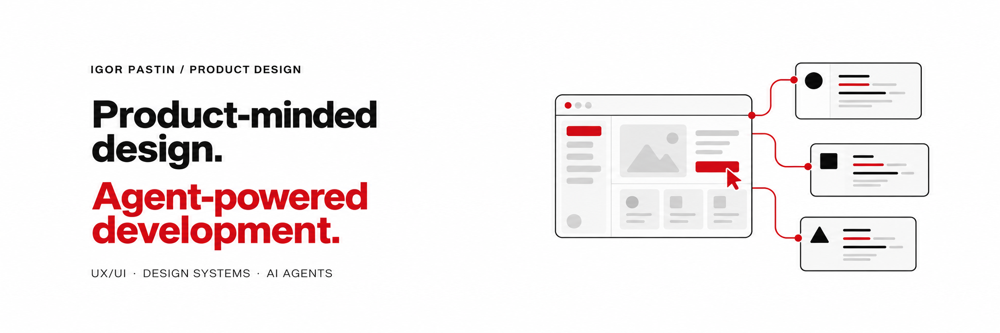

<!--
created: "23-10-26 09-36-59"
updated: "23-10-26 10-23-05"
timezone: "Europe/Moscow"
version: "0.4.2"
commit: "docs(profile): align copy with product design and AI-agent development"
-->

<h3>I'm Igor, a Senior Product Designer.</h3>

I design user experiences with a product vision and an engineering approach. Alongside my work with product teams, I build my own products with AI agents.

<a href="https://pastin.design">Portfolio ↗</a> · <a href="mailto:igor@pastin.design">Email</a>

<h2>What I'm building</h2>

<table width="100%">
<tbody>
<tr>
<td width="50%" valign="top">
<h3><a href="https://github.com/ipastin/sborum-bot">Sborum ↗</a></h3>

<strong>Will enough people show up?</strong>

Scheduled polls and quorum for one-time and recurring Telegram events.

Self-hosted · Cloudflare Workers

</td>
<td width="50%" valign="top">
<h3><a href="https://github.com/ipastin/ideomy">Ideomy ↗</a></h3>

<strong>Why did I decide that?</strong>

Notes, sources, projects, and decisions in an Obsidian Vault. Markdown stays the source of truth.

Local-first · Early development

</td>
</tr>
<tr>
<td width="50%" valign="top">
<h3><a href="https://github.com/ipastin/phisys">Phisys ↗</a></h3>

<strong>How has my health changed?</strong>

A personal health intelligence system for connecting scattered records over time.

Specifications · Early backend · App planned

</td>
<td width="50%" valign="top">
<h3><a href="https://github.com/ipastin/cuo">CUO ↗</a></h3>

<strong>How should AI tackle this?</strong>

An orchestration kit for Codex with reusable Skills, agent presets, and validation tools.

Skills · Agent presets · Validators

</td>
</tr>
</tbody>
</table>

How I work

I connect product goals with clear information architecture, interaction design, and design systems. I use AI agents to implement and iterate, while I own the product decisions and verify the results.

